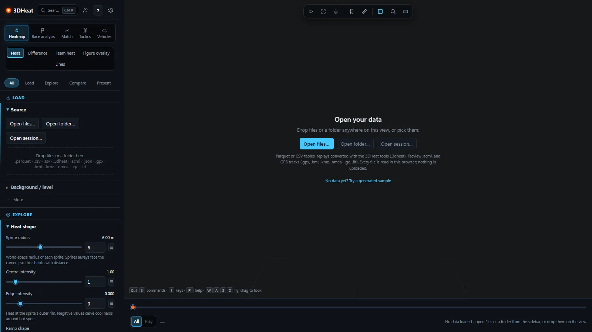

# Interface guide

How the viewer is laid out, and the quick ways to reach anything: the command palette, the key sheet, the task bar and the quick bar.

## First start: open your data

With nothing loaded, the Heatmap and Match views show the start screen:

1. Press **Open files…** (or **Open folder…** for a folder of matches), or drop files or a folder anywhere on the view. Parquet and CSV tables, replays converted with the 3DHeat tools (`.3dheat`), Tacview `.acmi` and GPS tracks open; the full list is in [Data formats](data-formats.md#files).
2. The files go to the **Source** panel, the first in the side panel: check the **Column mapping** (usually filled in already) and the **Memory estimate**, then press **Load**. See [Loading files](loading-files.md).
3. To put a level under the data, open **Map and background**. The start screen says how many levels are ready, in your library and in the levels folder the map tools write into.

**Open session…** opens a saved `.3dheat-session` (views, notes, the board, and the data it was made on by name); **Take up the last session** appears when this browser kept one. No data yet? The [demo data](demo-data.md) makes some, and the small link **No data yet? Try a generated sample** loads a made-up match for a first look.

## Layout

| Part | Where | What it holds |
|---|---|---|
| Header | Top of the side panel | The name, **Search…** (the command palette), **?** (help) and the gear (settings: theme, animations, units, language, developer tools) |
| Workspaces | Under the header | **Heatmap**, **Race analysis**, **Match**, **Tactics**, **Vehicles**. `Ctrl+Shift+1` … `5` |
| Task bar | Every workspace | **All** and the workspace's task groups (below): shows one group of panels at a time |
| Side panel | Left | The panels of the workspace, each a section that opens and closes. `Ctrl+B` hides it |
| Quick bar | Top of the view | The actions used most, one click each |
| Timeline | Bottom | Play, scrub and the time window (the race chart and the board's steps on their tabs) |

## Task groups

On every workspace the panels are grouped by what you are doing. Heatmap and Match:

| Group | Panels |
|---|---|
| **Load** | Source (what is loaded, **Open files…**, **Open folder…**, **Open session…**), Map and background, matches and series (Match). Under **More**: Many matches at once, and the developer tools when they are on |
| **Explore** | The heat or the figures, lines, teams, entities, filters, slice, the match's units, objectives and scoreboards |
| **Compare** | Difference split, volumes, insights, mass analysis, the ruler |
| **Present** | Saved views, camera path and video, Camera & scene. Under **More**: Performance |

The other workspaces:

| Workspace | Groups |
|---|---|
| **Race analysis** | **Load**: Laps, Map and background · **Analyse**: Course statistics, Where to improve, Corner by corner, Car control, Cars compared · **Present**: View, Camera & scene |
| **Tactics** | **Draw**: Tools (with the options of the tool in hand under them), the selection, Figures, Layers · **Plan**: Tasks, Timing, Compare with match data · **Load**: File (save, open, import a mission, clear), Map and background, the level's layouts (Objectives) · **Present**: Camera & scene. The game, the plan's name and the side stay above the task bar |
| **Vehicles** | **Load**: Source · **Explore**: Vehicle heatmap, hit areas, Look, Filter · **Analyse**: the tallies (penetration, hit areas, sides, body parts, modules) · **Present**: Camera & scene |

**All** shows every group, each under its name. A group only hides the others' panels; nothing is reset, and a filter or setting in a hidden panel keeps working. The task picked is kept per workspace.

Panels used now and then sit under **More** at the end of their group (and in **Heat shape**'s neighbours: *Distance culling*). **More** opens by itself while a panel inside it is open.

The viewer remembers, in this browser: which sections are open, the group picked on each workspace, which **More** folds are open, and whether the side panel is hidden. A panel that has something to show (a loaded file's mapping, a volume just drawn) opens by itself whatever was remembered.

## Command palette

`Ctrl+K`, or **Search…** at the top of the side panel. Type a few letters of what you want:

- an action (*Play / pause*, *Frame the action*, *Frame everything*, *Save the current view*, *Copy the camera position*, *Theme: Light*, *Keyboard shortcuts*);
- a workspace or task group (*Go to Match*, *Show the Compare panels*);
- a view mode (*Heat*, *Difference*, *Team heat*, *Lines*, *Figure overlay*);
- a camera view (*Camera: Top*, *Camera: Iso NE*, *Perspective*, *Parallel*);
- a panel (*Volumes*, *Camera path & render*);
- a setting in any panel, also in a closed one or on another workspace (*Sprite radius*, *Saturation point*, *Follow the view*);
- a saved view, by its name or its note.

`↑` `↓` move, `Enter` runs, `Esc` closes. Each line shows the group and the key, when there is one. A setting is *revealed*: the viewer goes to its workspace (and to the view mode that shows it), shows the side panel and the group, opens the sections around it, scrolls to it, highlights it and puts the keyboard focus on it - so the next arrow key or typed number changes it. With nothing typed, the last commands run come first.

Words are matched at their start first, anywhere in the label next, then in the panel's name. Accents do not matter (*echelle* finds *Échelle*).

The settings of panels that are not on the screen come from an index of the whole side panel that is read from the source code itself ([`tools/commandIndex.ts`](https://github.com/Holdi601/3DHeat/blob/main/tools/commandIndex.ts)) whenever the viewer is built or served, so a new panel or control is in the palette without a separate step. Labels kept in a table (the camera presets, the volume tools, the label fields of the figure replay) and labels made from a list of words count too; whatever is on the screen when the palette opens is read from the page as well.

## Key sheet

`?` (not while typing in a box) shows every key, grouped by where it works: everywhere, the Heatmap and Match views, the camera, the figure replay, the race and the tactics board, the current workspace's groups first. The same list, with links to what each key does: [Keyboard and mouse reference](keyboard-reference.md).

## Quick bar

Over the top of the view:

| Button | Does | Key |
|---|---|---|
| Play / pause | The timeline, the race or the plan, by workspace | `K` |
| Frame | Frames the action, the dense part of the data ([Camera](camera.md#framing)) | `F` (`Shift+F` frames everything) |
| Look straight down | The top view, framed, in a parallel projection. The button stays lit while the parallel view is on, and a second press goes back to 3D. A **Parallel view** badge at the bottom right of the view says the same, with a **Back to 3D** button | |
| Bookmark | Saves the current view under the next free name ([Saved views](saved-views.md)) | |
| Ruler | Opens [Measure](measure.md) with the ruler on (Heatmap) | |
| Side panel | Hides or shows it | `Ctrl+B` |
| Search | The command palette | `Ctrl+K` |
| Keyboard | The key sheet | `?` |

While a unit is followed, the bar shows its name and **Stop following** (`Esc`).

## Help

`F1` or **?** turns on the help mode: what the colours mean, and *Under the pointer* - the label or figure over the view, or the control in the side panel, the bars or the settings, named with what its tooltip or hint says. `F1` works with the focus in any control. See [Settings, units and keys](settings.md#help-mode).

## Look and accessibility

- **Theme**: dark by default; **Light** and **System** in the settings. The 3D view and everything drawn over it stay dark. Team colours are the team palette's (*Auto*, *Soft*, *Strong*, *Strong alt*) in every theme.
- **Animations**: **Auto** turns transitions, glows and blur off while the view runs under 30 fps and back on when it recovers; the system's *reduce motion* setting always wins.
- Every control is reachable with `Tab`, shows a ring in the accent colour when it has the keyboard focus, and section headers open and close with `Enter` or `Space`. Text meets WCAG AA contrast in both themes.

Colours, spaces, radii, type sizes, shadows and durations are design tokens on the page root ([`app.css`](https://github.com/Holdi601/3DHeat/blob/main/src/app.css)); the light theme redefines the colours only.

## Developer tools

Off by default, and not needed to analyse anything: they are for checking performance and debugging the viewer. **Developer tools** in the settings (the gear) turns them on and keeps the choice in this browser; `?dev` in the address turns them on for one page. With them on:

- **Developer tools → Test data (performance check)** under **More** in the Heatmap's **Load** group: made-up data of any size ([Test data](synthetic-generator.md));
- the full [stats overlay](performance-and-stats.md#the-stats-overlay) at the top right of the view (without them only the amber **Not resident** line shows there, when rows did not fit on the graphics card);
- **Sprites / frame** and **Progressive refinement** in the Performance panel, **Sprite pixel clamps** beside Heat shape, and the heap and per-column bytes in **Memory in use**.

The command palette offers *Show developer tools* and *Hide developer tools*, and lists their panels only while they are on.
