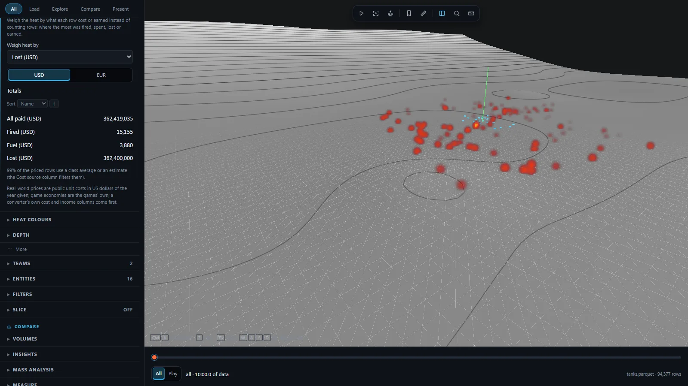

# Value weighting

Every shot, munition, lost vehicle and litre of fuel has a price. The viewer works out what each row cost or earned and can weigh the heat by it, so the map shows **where the money went** instead of where the rows are.

## How to use it

1. Load data with events (shots, kills, deaths) and vehicle or weapon names.
2. Open **Value** in the Heat sidebar.
3. Pick **Weigh heat by**, for example *Lost (USD)*. The heat now adds each row's price instead of 1.
4. Read **Totals**: the sum of every value column for what is shown (filters and time window apply).
5. Where the prices are real-world money, a **USD / EUR** switch appears.

Pick the empty entry to count rows again.

## What can be weighed

The value columns are added at load, one per kind and currency:

| Kind | Rows it lands on | How it is priced |
|---|---|---|
| **Fired** | shots and launches | the weapon, else an average for the kind of munition |
| **Spent** | buying, spawning | money columns of the game (for example a shooter's buy menu) |
| **Lost** | deaths, destroyed | the own vehicle, else the average of its class |
| **Destroyed** | kills | the target vehicle |
| **Damage dealt** | hits | a share of the target's value |
| **Fuel** | positions | fuel used, from a fuel column or estimated from the class and time |
| **All paid** | | fired + spent + lost + fuel |
| **Earned** | rewards | the game's own reward columns (`earn_…`) |
| **Net** | | earned minus paid; drawn as signed heat (positive ramp where more was earned, negative where more was paid) |

The column names are `cost_<kind>_<currency>`, `earn_<currency>` and `net_<currency>`. A converter that knows the game's own currency (for example a replay converter writing in-game credits) wins over the built-in price tables.

## The price tables

| Table | Currency |
|---|---|
| Real-world military: missiles, bombs, rounds, countermeasures, aircraft, helicopters, ground vehicles, ships, fuel | USD (EUR = USD × 0.92) |
| Shooter buy menus and kill rewards | the game's credits |
| Tank and ship games | the game's credits |
| Strategy games (several resources) | one column per resource plus a combined one |
| Wargames | points |

The game is recognised from names in the data. Real-world prices come from public sources (budget documents, encyclopaedias) or are marked as estimates; they are not adjusted for inflation. The generated list of tables is on [Value tables](ref-value-tables.md).

## Estimates

The extra category column **Cost source** says how each row was priced: `table`, `class average`, `estimate` or `none`. The Value section shows which share of the priced rows are averages or estimates. To keep only exactly priced rows, untick *estimate* and *class average* under **Cost source** in [Filters](filters.md).

## Where else value shows

- [Insights](insights.md): *Costly ground* and *Earning ground* findings.
- [Breakdown](breakdown.md): Earned, Lost and Net money per team, player or weapon.
- [Volumes](volumes.md): value columns in the statistics and the comparison.
