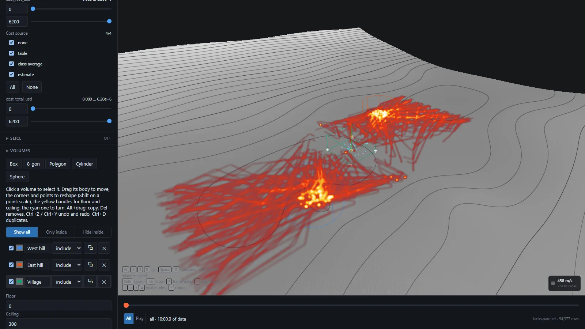

# Volumes and comparison

A **volume** is an invisible box (or cylinder, or sphere) that you draw around a place, to ask: what happened in here? Use it to count kills at a bridge, to compare two hills, or to show only the activity in one area.

```
 top view                 You draw a shape ->  the viewer counts
 +------------+           what is inside:
 |   ( A )    |            rows, players, kills, time ...
 |        [B] |           Compare A with B, side by side.
 +------------+
```



Volumes measure what happens inside them, filter the view to them, export their rows, and can be compared side by side. See also the [glossary](glossary.md) for row, person and match.

## Draw a volume

1. Open **Volumes** in the sidebar.
2. Pick a tool and draw in the 3D view or on the 2D map. Floor and ceiling start from the data underneath. Esc cancels.
3. Click the volume to select it; its **Statistics** appear.

| Tool | How to draw |
|---|---|
| **Box** | Drag a rectangle (Shift: a square). A click places a default box. |
| **n-gon** | Drag from the centre (Shift keeps it regular). *Corners* sets n, from 3 to 64 (default 8, so the button reads **8-gon**). |
| **Polygon** | Click the corners; close with a double-click, Enter or a click on the first corner. Backspace removes the last corner. |
| **Cylinder** | Drag the radius. |
| **Sphere** | Drag the radius; it rests on the ground. |

## Edit

- Click a volume to select it. Drag its body to move it, corners to reshape it (Shift on a corner scales).
- The **yellow** handles set floor and ceiling, the **cyan** handle turns it.
- Alt+drag copies, Del removes, Ctrl+Z / Ctrl+Y undo and redo, Ctrl+D duplicates. **Remove all** deletes every volume.
- Exact values: Floor, Ceiling, Turn / Pitch / Roll (boxes), Radius (spheres, cylinders).

Each volume row has a show checkbox, a colour, a name, **include** or **exclude**, duplicate and delete. Volumes are saved in the browser for each dataset, and **Save...** / **Load...** write and read a `volumes.json` file.

## Filter the view

| Filter | Effect |
|---|---|
| **Show all** (default) | Volumes only measure. |
| **Only inside** | Heat, replay and [hit analysis](hit-analysis.md) draw only what is inside the included volumes and outside the excluded ones. |
| **Hide inside** | The opposite. |

The GPU filter takes up to 8 volumes with 64 outline points in all; a "!" marks a volume past that. Statistics and export still count it.

## Lines on the level

Each visible volume draws a line in its colour where it cuts the level: along the ground, up the walls, over every surface it passes through. A volume then reads as the ground it takes in, not as a box floating over the map.

| Control | Default | Meaning |
|---|---|---|
| **Lines on the level** | on | Draw them. Remembered in this browser. |
| **Line width** | 1.5 px | 0.5-6 px. |

The lines are drawn in every mode (heat, replay, tactics...), over the picture and so over the heat, for the first 8 visible volumes the GPU tests (the same ones the filter applies). They are computed on the GPU from the scene's depth each frame: the world position of each pixel is rebuilt and each volume's boundary function (zero on its surface) is evaluated there; a pixel the boundary crosses is lit, with the width measured in pixels so the line keeps its width at any distance. Where the next pixel is a different surface (an edge in the depth, the sky) no line is drawn. Nothing is read back and no geometry is built ([`volumeContours.ts`](https://github.com/Holdi601/3DHeat/blob/main/src/render/volumeContours.ts)).

## Statistics

The **Statistics** area follows the filters, the time window and hidden groups. *Selected* shows the selected volume, *Compare all* puts every volume side by side. It shows:

- **Rows inside (shown)** and **Rows inside (all data)**, **Players**, **Teams**, **Matches**, **Time inside**, **Entries / exits**, **Peak heat**, **Mean heat**, **Volume / footprint** and a **When** histogram;
- **Win rate**, where the data says who won ([outcome columns](data-formats.md#outcome-columns)): of the rounds with a player inside, each player's round counted once, the share their side won - pulled toward the rate over everything shown by 4 rounds, as the [breakdown](breakdown.md) does - with the rounds won and played and that overall rate;
- per column: categories with **Lift** (share inside divided by share in all shown data), and numbers with range, median and 5th-95th percentiles.

**Statistics as CSV / JSON** save them. **Export the data inside** writes the rows inside as CSV or Parquet (*Only the rows shown* on by default), one volume or all with a column saying which volume holds each row.

## Compare volumes

With two or more visible volumes, press **Compare...**.

1. Draw three volumes, for example West hill, East hill and Village.
2. Press **Compare...** under Statistics.
3. In **Table**, read each value's difference from the first volume.
4. Switch to **Bars** to see the shares as bars.


| View | Shows |
|---|---|
| **Table** | Rows, time inside, players, matches, teams, entries, exits, visits, visit length, kills, deaths, kills per death, kills per minute, time per player, value columns; grouped by events, vehicle class, player or AI, team and facing. Each value shows its difference from the first volume and an effect size (negligible, small, medium, large). Click a volume's heading to sort by distance from the first. |
| **Bars** | Counts or shares by event, class, actor, team or direction. Click a bar to filter the view to it. |
| **Over the match** | One chart per volume over the minutes of the match: presence, rows or kills. Click to jump there. |
| **Visits** | Box and violin plots of how long visits last (log scale). |
| **Flow** | Where tracks go after leaving each volume: a transitions matrix or flow ribbons. |


## Tips

- Start from a finding: in [Insights](insights.md), **Volume here** adds a cylinder round the finding's place.
- **Charts on a volume**: the small chart button at a volume's top corner puts charts of the rows inside it beside it in the world: [Charts on volumes](volume-charts.md).
- **Breakdown...** opens the [Breakdown](breakdown.md) for the selected volume: who and what does best inside it.
- **Compare groups...** compares any groups - teams, vehicles, players, files, matches, your own filters - inside the volumes (combined or each) or the whole map, with your own statistics: [Compare groups](compare-groups.md).
- [Directional heat](directional-heat.md) can chart the directions inside the selected volume.
- The [Vehicles tab](hit-analysis.md#restrict-to-an-area) uses the same volumes as its area filter.
