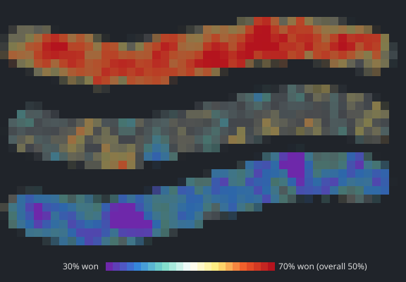

# Win rate: how often a place, a route or a play wins

Where a player stands, which way they go, where they throw their utility - and how often their side then wins the round. The **win-rate map** colours each place by the share of the rows there that belong to rounds the row's side won, against the share over everything shown: warm where it is higher, cool where it is lower, nothing where it is the same.

*The picture is made-up data: three routes on an empty level, 68%, 50% and 33% of their rows in won rounds.*

It needs data that says who won: the [outcome columns](data-formats.md#outcome-columns) (`won`, `matchWon`, `roundEndReason`). The CS2 and War Thunder converters write them; any file can.

## Try it

1. Load matches with an outcome column and press `2` (**Difference**).
2. In **Difference split**, press **Round win rate** (or **Match win rate**). It puts the won rounds on **+** and the lost ones on **−** and switches the panel to **Share of +**.
3. Read the colours. The panel says the overall share: *Overall 52.0% of 1,200,000 rows are on +.*
4. Narrow it with the [filters](filters.md): one side (T or CT), one event type (*Position* for where people stood, *Shot fired* or *Launch* for where they shot or threw from), one buy, one map.

A place that is warm with *Position* rows is a place whose holders tended to win the round. With *Kill* rows it is a place where the kills that were made led to won rounds.

## The settings

| Setting | What it does | Default |
|---|---|---|
| **Difference** / **Share of +** | the difference itself, or the + side's share of the rows on either side | Difference |
| **Full colour at** | how far above or below the overall share a place is shown at full colour, in points | ± 20 points |
| **Fewest rows to colour a place** | a place with fewer rows is not coloured; it fades in from half of it | 12 |
| **Pull toward the overall share (rows)** | each place starts from this many rows at the overall share, so a place on 3 rows, all won, is not shown as 100% | 12 |

All three act on the finished picture: dragging them never restarts the accumulation.

The share is any split's, not only wins: *Share of +* with a split by side shows where the Ts were the larger part of the presence, and with a split by two maps' files where one file's rows outweigh the other's.

## Rows, not rounds

The map counts rows. A player who stands in one spot for twenty seconds adds a row each sample, all from one round, so the evidence at a place is the rows near it, not the rounds. That is why the minimum and the pull are in rows, and why they are larger than one round's worth.

For the rounds themselves:

- **[Breakdown](breakdown.md)** on a spot, the view or a volume: *Win %* counts each player's round once, pulled toward the place's overall rate the same way (4 rounds).
- **[Volumes](volumes.md)** statistics: *Win rate* - the rounds with a player inside the volume, each once, pulled toward the rate over everything shown, with the counts.

## Outcome filters

The [Filters](filters.md) panel lists the outcome columns right after the viewer's own: **Round result** and **Match result** (*Any*, *Won*, *Lost*) and **How the round ended** (elimination, bomb exploded, bomb defused, time ran out, surrender, draw, objective, zones held, tickets lost, all vehicles lost), in the viewer's language.

## For developers

The heat pass writes three sums into the four-channel target that team heat uses: the heat `R = Σ|v|`, the + side's heat `P`, and `S = Σ v²/w` with `w` the pass's weight (sampling weight times frame gain). The composite reads the share `P/R` (a kernel-weighted mean) and the rows it rests on `n = R²/S` (Kish's effective sample size), pulls the share toward the overall one, `p = (n·P/R + m·r0)/(n + m)`, and colours `p - r0` over the span on the difference ramps.

`n` divides out every factor common to the rows at a pixel - the frame gain, the sampling weight, a clamped sprite's area weight - so the picture is the same at any zoom and sampling density, and frames of every k-th row merge to the whole without the colours jumping. The overall share comes from the CPU's side counts, held to tenths of a per cent; nothing is read back from the GPU. The arithmetic and its checks: [`render/rateMap.ts`](https://github.com/Holdi601/3DHeat/blob/main/src/render/rateMap.ts) and its test.

It costs what team heat costs: the four-channel target quadruples the heat pass's blend bandwidth, only while *Share of +* is on.
